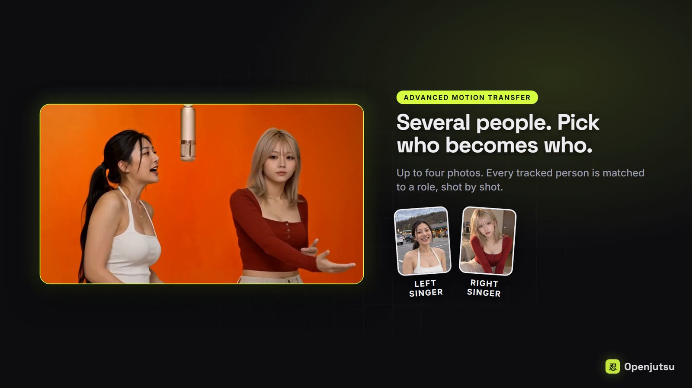
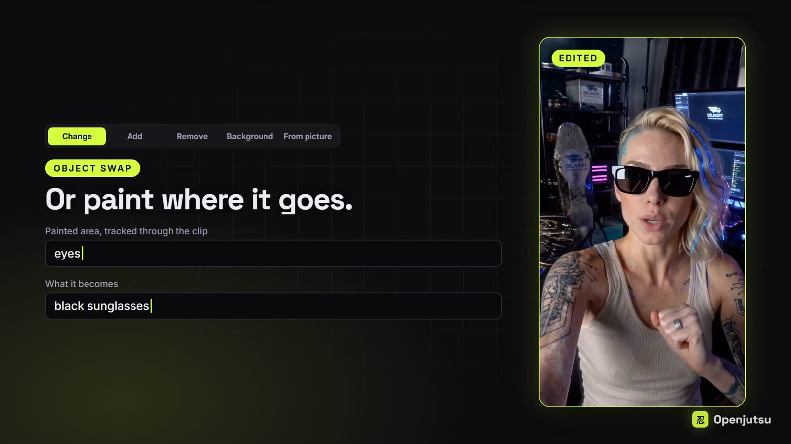
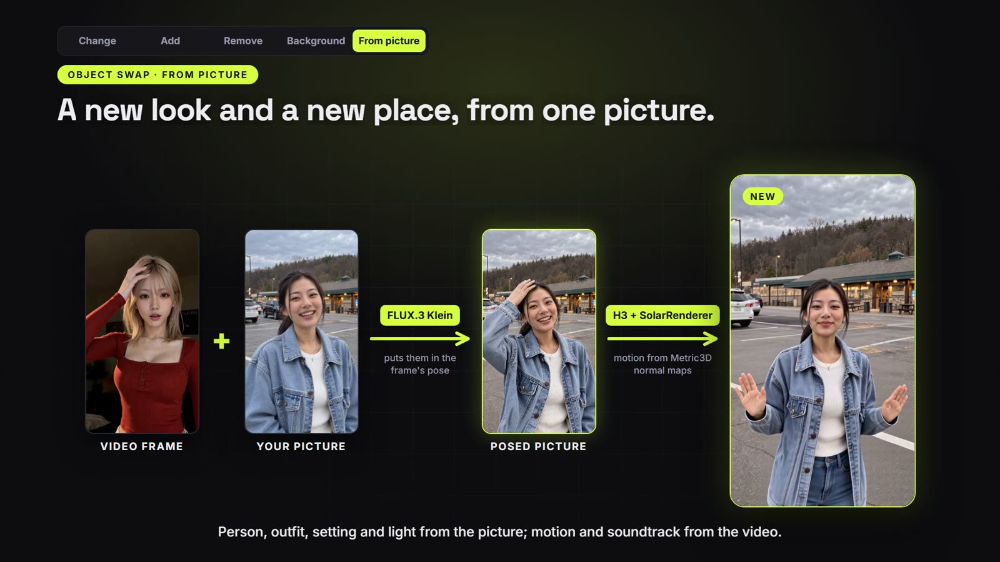
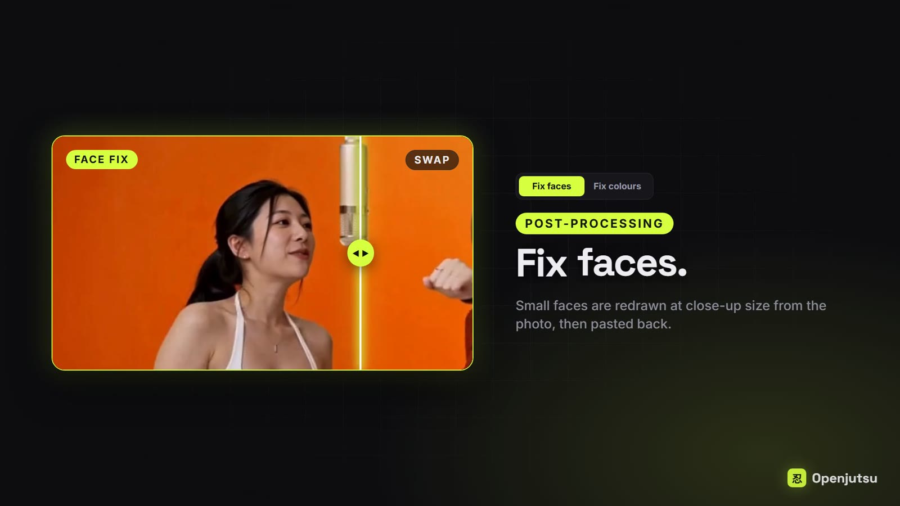
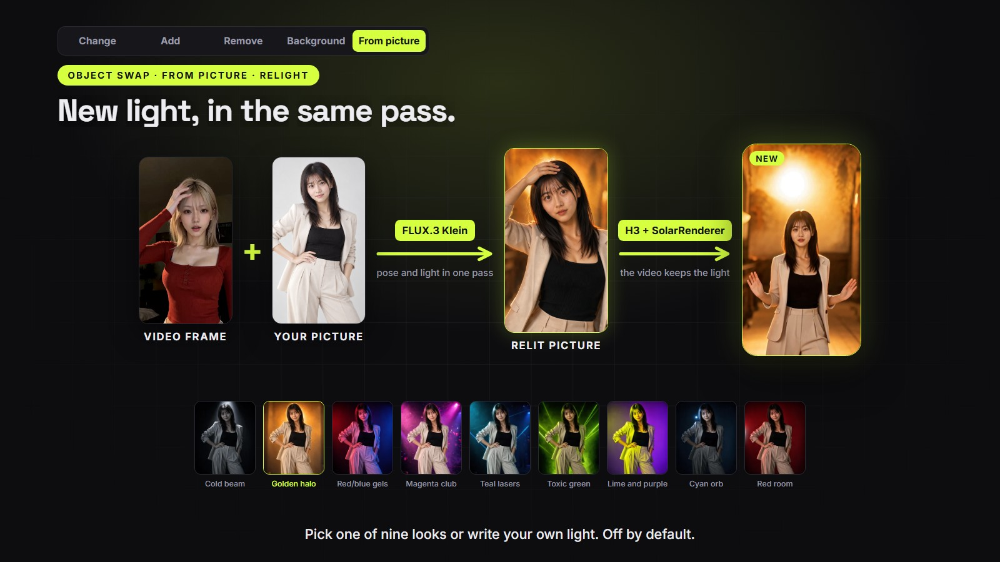

# Openjutsu

> English version: [`README.en.md`](README.en.md)

Cambio de personaje y de objeto para vídeo, de código abierto y al estilo Genjutsu. Arrastra un vídeo y una foto de personaje, pulsa **Generar** y la persona principal del vídeo se sustituye por tu personaje. También puedes cambiarle el pelo o la ropa, quitar algo o llevarla a otro sitio. La cámara, los cortes, el movimiento y la banda sonora se mantienen. Todo funciona con pesos abiertos en tu propia GPU: MiniMax H3 para el vídeo, SAM 3.1 para seguir a las personas y Qwen3-VL 8B para describir las fotos y los planos.

La aplicación es un pequeño front end de Next.js sobre un flujo de ComfyUI. Usa [`@comfyorg/sdk`](https://www.npmjs.com/package/@comfyorg/sdk), siguiendo la aplicación de referencia [comfy-reshoot](https://github.com/Comfy-Org/comfy-reshoot) de Comfy.

https://github.com/user-attachments/assets/2d8d763a-1764-49a6-9116-d6d1be661ff6

| Cambio avanzado: varias personas, elige quién se convierte en quién | Cambio de objeto: pinta dónde va |
| --- | --- |
|  |  |
| **Desde una foto: aspecto y lugar nuevos desde una sola foto** | **Posprocesado: corregir caras** |
|  |  |

**Desde una foto → Iluminación: luz nueva en la misma pasada**



## Primera visita: descriptor visual

La página de bienvenida te deja elegir el modelo de visión y lenguaje que describe las fotos y los fotogramas y escribe los prompts. Qwen3-VL 8B INT8 sigue siendo el valor por defecto; Qwen3-VL 4B FP8 y Gemma 4 E2B INT8 son alternativas más pequeñas. Instala en `ComfyUI/models/text_encoders` un modelo compatible de archivo único, con sus pesos de visión, y pulsa **Actualizar modelos**. Se pueden elegir otros modelos instalados si admiten entrada de imagen o vídeo y generación de texto con los nodos CLIPLoader y Generate Text de ComfyUI. Los modelos solo de texto y los archivos que necesitan otro cargador no sirven.

Elige según la VRAM disponible y deja margen para el contexto de imagen y vídeo y la memoria de trabajo; el tamaño del archivo no es un requisito de VRAM, y la generación con H3 tiene sus propias necesidades de memoria. Tu elección se guarda en este navegador y se usa para los cambios, las descripciones de prompts y **Buscar personas**. Vuelve a abrir **Bienvenida y modelos** para cambiarla, o usa **Descriptor visual** en Componentes del modelo. Otras opciones de descriptor pueden cambiar la calidad de los prompts y el emparejamiento de personas. **Configurar más tarde** abre el editor; la generación sigue comprobando los archivos necesarios. El codificador de texto de H3 es independiente y no cambia.

## Modos

- **Transferencia de movimiento simple**: disponible. Un personaje sustituye a la persona principal (la que ocupa más parte del fotograma). Ejecuta `workflows/simple.api.json`, exportado de `H3 One-Click Single Swap (DMAD 6 step).json`.
- **Transferencia de movimiento avanzada**: disponible. De 1 a 4 personajes, cada uno con un rol opcional; cada persona seguida se empareja con un rol por plano, y las personas sin personaje se quedan intactas. Ejecuta `workflows/advanced.api.json`, exportado de `H3 One-Click Advanced Swap (DMAD 6 step).json`; **Una pasada por persona** (dos personajes) ejecuta `workflows/advanced_maxq.api.json`.
- **Cambio de objeto**: disponible. **Cambiar** lo que sigue SAM (el pelo, una chaqueta, un coche) por lo que describes o muestras en una foto; **Quitar** ese elemento; o cambiar el **Fondo** a su alrededor (`person` se queda). Solo se regenera esa zona. Ejecuta `workflows/object.api.json`, exportado de `H3 One-Click Object Swap (DMAD 6 step).json`.
- **Desde una foto** (dentro de Cambio de objeto): FLUX prepara el personaje en la pose y el recorte del cuerpo del fotograma original, manteniendo el fondo de la foto del personaje. Revisa o regenera la imagen y pulsa **Usar esta imagen** para fijar la duración del vídeo, las resoluciones del vídeo y de la referencia de movimiento, los modelos, las LoRAs, los pasos y la semilla. SolarRenderer usa cuatro pasos por defecto, con un par de LoRAs de cuatro pasos y de control de rango 384 o 64, y admite hasta 15 segundos, igual que el renderizador H3 nativo. Los clips de SolarRenderer de más de seis segundos pueden tardar bastante más en renderizarse, sobre todo a resoluciones altas; consulta los requisitos del flujo para el arreglo del nodo de silencio extendido. Los dos selectores de LoRA admiten `models/loras` y sus subcarpetas. **Usar esta imagen** también hace que el descriptor visual vea la parte y escriba lo que ocurre (acciones, objetos en la mano, expresiones), y después lo reescriba para la imagen preparada; revisa y edita esa descripción del vídeo antes de renderizar. **Renderizar vídeo** reutiliza la vista previa guardada con la guía de movimiento por mapas de normales, la descripción del vídeo y la banda sonora original, en un solo clip y sin bucle de contexto. H3 redondea la duración pedida a su rejilla de fotogramas válida. **Iluminación** (desactivada por defecto) cambia la luz en la misma pasada de FLUX: elige una de las diecisiete luces, cada una con una imagen de ejemplo, o describe tu propia luz. FLUX entonces solo ve tu foto, y el ampliador de prompts Qwen 3.5 9B lee la pose del fotograma del vídeo. Magenta club y Teal lasers prácticamente solo recolorean el fondo. **Iluminar de nuevo a la persona del vídeo** se salta la foto de personaje: FLUX vuelve a iluminar el fotograma del vídeo, conservando su persona, pose y escena. Consulta [los requisitos del flujo](workflows/picture/README.md).
- **Posprocesado**: disponible, para un vídeo terminado. **Corregir caras**: H3 dibuja mal las caras cuando la persona es pequeña en el fotograma, así que esto redibuja la cara de la persona de una foto a tamaño de primer plano y la pega de vuelta. Ejecuta `workflows/face.api.json`, escrito por `workflows/build/openjutsu_face_build.py`. **Corregir colores** suaviza el aspecto duro de H3 sin ejecutar H3: Image Detail Contrast quita algo de contraste de detalle fino y después el DCTL Tone Mapper de Orion4D etaloniza cada fotograma. Ejecuta `workflows/color.api.json`.

## Requisitos

- Una GPU NVIDIA. Probado en una RTX 4060 Ti de 16 GB con 64 GB de RAM de sistema; los modelos int8 de H3 se transmiten desde la RAM.
- [ComfyUI](https://github.com/comfyanonymous/ComfyUI) 0.41.2 o superior. El núcleo aporta MiniMax H3, SAM 3.1 y TextGenerate.
- Node.js 22.13 o superior (la base de datos usa `node:sqlite`), y Python para `comfy-api-proxy`.

### Nodos personalizados

Instálalos en `ComfyUI/custom_nodes` (ComfyUI Manager encuentra los tres primeros por su nombre):

| Pack | Para qué se usa |
| --- | --- |
| [SolarRenderer](https://github.com/Enderfga/SolarRenderer/tree/main/comfyui) | Desde una foto: carga de LoRAs de SolarRenderer, condicionamiento y muestreo de cuatro pasos |
| [ComfyUI-MiniMaxH3-Context-Loop](https://github.com/ethanfel/ComfyUI-MiniMaxH3-Context-Loop) 0.7.3+ | bucle de clips, puntos de control, ensamblado final |
| [ComfyUI-Fantastic-MiniMaxH3-PromptBuilder](https://github.com/Adudeguyman/ComfyUI-Fantastic-MiniMaxH3-PromptBuilder) | latente de edición de vídeo enmascarado |
| [ComfyUI-KJNodes](https://github.com/kijai/ComfyUI-KJNodes) | Grow Mask With Blur; Desde una foto: limpieza de VRAM |
| [comfyui_controlnet_aux](https://github.com/Fannovel16/comfyui_controlnet_aux) | Desde una foto: mapas de normales Metric3D |
| [ComfyUI-VideoHelperSuite](https://github.com/Kosinkadink/ComfyUI-VideoHelperSuite) | carga de vídeo |
| [comfyui-h3-oneclick-swap](https://github.com/D3voz/comfyui-h3-oneclick-swap) | planes de cambio y de objeto, máscaras de personas y roles, maniquíes grises, etiquetado de seguimientos, buscador de cortes, lista de planos, bloques de corrección de caras |
| [ComfyUI-H3-FaceRefine](https://github.com/Carasibana/ComfyUI-H3-FaceRefine) | Corregir caras: seguimiento y recorte de cara, máscaras SAM de cara, pegado de vuelta |
| [ComfyUI-Impact-Pack](https://github.com/ltdrdata/ComfyUI-Impact-Pack) | Corregir caras: cargador SAM |
| [comfyui-image-detail-contrast](https://github.com/D3voz/comfyui-image-detail-contrast) | Corregir colores: Image Detail Contrast |
| [Orion4D_FXMax](https://github.com/orion4d/Orion4D_FXMax) | Corregir colores: DCTL Tone Mapper y sus preajustes |
| [comfyui-websocket-reconnect-fix](https://github.com/D3voz/comfyui-websocket-reconnect-fix) | en todos los trabajos: mantiene el progreso en vivo cuando el proxy se reconecta a ComfyUI (no añade nodos) |

Reinicia ComfyUI después de instalarlos.

Antes de subir un trabajo, Openjutsu comprueba el flujo seleccionado contra las listas de nodos y modelos de ComfyUI. Los packs que faltan aparecen con enlaces de instalación; los archivos de modelo que faltan aparecen con su carpeta de destino. Los pasos desactivados se excluyen de la comprobación. Esto comprueba nodos registrados y archivos de modelo listados, no dependencias de Python, la integridad de los modelos ni la VRAM disponible. `COMFYUI_URL` debe apuntar a ComfyUI (normalmente `http://127.0.0.1:8188`).

### Modelos

Para **Desde una foto → SolarRenderer**, descarga [solarrenderer_4step_lora.safetensors](https://huggingface.co/Enderfga/SolarRenderer/blob/main/solarrenderer_4step_lora.safetensors) y [solarrenderer_control_lora.safetensors](https://huggingface.co/Enderfga/SolarRenderer/blob/main/solarrenderer_control_lora.safetensors) desde [Enderfga/SolarRenderer](https://huggingface.co/Enderfga/SolarRenderer), o el par equivalente de rango 64 desde [mdevoz/SolarRendererRank64](https://huggingface.co/mdevoz/SolarRendererRank64). Pon los dos en `ComfyUI/models/loras` o en una subcarpeta, recarga la aplicación y elige sus rutas en los ajustes de render.

| Carpeta en `ComfyUI/models` | Archivo |
| --- | --- |
| `diffusion_models` | `minimax_h3_ref2va_pruned_int8_convrot.safetensors` |
| `loras` | `minimax_h3_DMAD_4step_full_lora_avg_rank_39_bf16.safetensors` |
| `text_encoders` | `qwen3vl_32b_minimax_h3_int4_convrot.safetensors` (codificador de texto de H3) |
| `text_encoders` | `qwen3vl_8b_int8_convrot.safetensors` (descriptor visual) |
| `vae` | `minimax_h3_video_vae_int8_convrot.safetensors`, `minimax_h3_audio_vae_fp32.safetensors` |
| `checkpoints` | `sam3.1_multiplex_fp16.safetensors` |
| `ultralytics/bbox`, `ultralytics/segm` | `face_yolov8m.pt`, `person_yolov8m-seg.pt` ([Bingsu/adetailer](https://huggingface.co/Bingsu/adetailer)), para Corregir caras |
| `sams` | `sam_vit_b_01ec64.pth`, para Corregir caras |
| `insightface/models` | `buffalo_l` (InsightFace lo descarga la primera vez), para Corregir caras |

## Ejecutarlo en local

En Windows, haz doble clic en `start_openjutsu.bat` (ComfyUI debe estar ejecutándose, o se inicia mientras espera). La primera ejecución instala `comfy-api-proxy` 0.1.6 en `.venv-proxy` y los paquetes de Node, y `patch_proxy.py` arregla el progreso en vivo del proxy (cambios de nodo y vistas previas a mitad de trabajo). Cada ejecución construye la aplicación, abre el proxy y la aplicación (`npm start`, el servidor de producción) en dos ventanas y la página en tu navegador. Cierra esas dos ventanas para detener Openjutsu. Los pasos manuales:

1. Inicia ComfyUI en `127.0.0.1:8188`. En Windows, define antes `AIOHTTP_NOSENDFILE=1` (PowerShell: `$env:AIOHTTP_NOSENDFILE = "1"`). Sin eso, la primera petición de archivo parcial (el reproductor envía una al hacer seek) puede bloquear el `/view` de ComfyUI, y todas las descargas posteriores se colgarán hasta reiniciar ComfyUI.
2. Instala el proxy, arregla su progreso en vivo con el `patch_proxy.py` de este repositorio (ejecútalo con el mismo Python) y arráncalo. Sirve la API v2 de Comfy en `127.0.0.1:8189`. Sube el límite de subida para vídeos largos (por defecto 100 MB):

   ```sh
   pip install comfy-api-proxy==0.1.6
   python openjutsu/patch_proxy.py
   comfy-api-proxy run --max-upload-mb 500
   ```

3. Instala y arranca la aplicación:

   ```sh
   git clone <este repositorio> openjutsu
   cd openjutsu
   cp .env.example .env.local
   npm ci
   npm run build
   npm start
   ```

   Mientras cambias el código, `npm run dev` arranca el servidor de desarrollo.

4. Abre <http://127.0.0.1:3000>.

`.env.local` define `COMFY_BASE_URL=http://127.0.0.1:8189`. Deja `COMFY_API_KEY` vacío para un proxy local. Los selectores de modelo base y de LoRA leen las listas de modelos de ComfyUI desde `COMFYUI_URL` (por defecto `http://127.0.0.1:8188`); sin esa URL pasan a ser campos de texto.

Las subidas están limitadas a 512 MB en total por petición, incluidas las fotos de referencia. Se transmiten a una carpeta temporal y pueden llegar hasta tres a la vez por proceso de la aplicación; a la cuarta se le pide reintentar en un momento. Al terminar un trabajo, sus subidas se borran de comfy-api-proxy, pero los archivos se quedan en la carpeta `input/` de ComfyUI. La generación continúa en ComfyUI de forma independiente.

Un clip de 6 s a 480p tarda entre 6 y 13 minutos en una 4060 Ti, la mayor parte en el muestreo de H3. 736p es el valor por defecto; 1080p es unas 2,5 veces más lento que 736p y necesita mucha más memoria. Personalizado fija un ancho × alto exacto de 256 a 2048 px por lado (redondeado a 32); el vídeo se escala y se recorta al centro con esa forma primero. Necesita la entrada `short_edge` de los nodos H3 Swap Plan de comfyui-h3-oneclick-swap.

La transferencia de movimiento avanzada tiene una pestaña **Montaje** para clips editados en los que varias personas se turnan dentro de un mismo plano sin un corte claro (barridos de cámara, pasos de selfi, montajes de viaje). Escribe los roles como "quién - aspecto" ("la bailarina - polo blanco, vaqueros"): el aspecto ayuda a emparejar a las personas, y a H3 solo le llega la parte anterior a " - ". **Generar** sigue a todo el mundo con SAM por el vídeo entero, empareja cada aparición con los roles usando Qwen (una persona que SAM pierde y vuelve a encontrar se empareja otra vez, así conserva su foto; Qwen ve cada aparición en su fotograma y de cerca en tres momentos, unas pocas apariciones a la vez, y se le vuelve a preguntar por las que se salta o por las que empareja dos veces con la misma foto en el mismo momento) y hace el vídeo como una sola cadena igual que Estándar, con clips solapados: cada clip tiene una pasada de H3 por cada foto en pantalla (las dos con más tiempo en pantalla) que enmascara solo las apariciones de esa foto, con un prompt sobre esa persona únicamente. Las apariciones en pantalla menos de 12 fotogramas o por debajo del 2 % del fotograma se quedan como están, porque H3 las dibuja como figuras grises; la página de resultado las lista. **Buscar personas** (unos 3 minutos para 18 s de vídeo) es la revisión opcional: hace solo el seguimiento y el emparejamiento, lista las apariciones con un selector de foto para cada una y guarda los seguimientos, y Generar desde esa lista enmascara con exactamente esos seguimientos. Los seguimientos guardados viven en la carpeta temporal de ComfyUI y se comprueban contra el vídeo, la parte y el tamaño, así que tras reiniciar ComfyUI o cambiar algo, vuelve a usar Buscar personas. Necesita los nodos del pack `H3TrackCrops` y `H3TrackRoles` (que ahora ejecuta Qwen por su cuenta), `H3MontagePeople`, `H3MontageTracks`, `H3MontagePicks`, `H3MontagePlan` y `H3MontagePass`.

## API HTTP

Además de la interfaz web, Openjutsu expone una API JSON en `/api/v1` para lanzar, consultar y reexportar trabajos desde scripts, cuadernos de Colab u otros servicios. La documentación completa, con ejemplos en `curl` y Python, está en [`docs/API.es.md`](docs/API.es.md).

Resumen:

| Método | Ruta | Qué hace |
| --- | --- | --- |
| `GET` | `/api/v1/health` | Estado del servidor, de ComfyUI y de la base de datos |
| `GET` | `/api/v1/jobs` | Lista los trabajos guardados (`limit`, `status`, `kind`) |
| `POST` | `/api/v1/jobs` | Envía un trabajo nuevo (`multipart/form-data`, los mismos campos que la interfaz) |
| `GET` | `/api/v1/jobs/{id}` | Detalle de un trabajo, con sus eventos |
| `GET` | `/api/v1/models` | Modelos, LoRAs, codificadores y VAE instalados en ComfyUI |
| `GET` | `/api/v1/stats` | Conteos por estado y por tipo, y tamaño de la base de datos |
| `GET` | `/api/v1/db/export` | Descarga la base de datos (`?format=sqlite` para el archivo `.db`) |
| `POST` | `/api/v1/db/import` | Restaura una base de datos exportada |

La autenticación es con `Authorization: Bearer $OPENJUTSU_API_KEY` o `x-api-key: $OPENJUTSU_API_KEY`. Si la clave está vacía, la API v1 sigue disponible pero solo mediante el login Basic de la aplicación. Con clave, no se aplica la comprobación de origen del navegador, así que un script o un cuaderno pueden llamarla. La creación de trabajos usa `multipart/form-data` en la misma ruta que la interfaz (`/api/v1/jobs` es un alias de `/api/jobs`), con un límite de 512 MB por petición.

```sh
# Lista los últimos trabajos
curl -H "Authorization: Bearer $OPENJUTSU_API_KEY" \
  "http://127.0.0.1:3000/api/v1/jobs?limit=5"
```

## Persistencia en SQLite

Los trabajos se guardan en SQLite con el módulo `node:sqlite` de Node (sin dependencias nativas, cómodo en Colab). Archivo por defecto: `data/openjutsu.db`; cámbialo con `OPENJUTSU_DB_PATH`. Desactívalo con `OPENJUTSU_DB=off`.

- Tablas: `meta` (versión del esquema), `jobs` (un registro por trabajo, con su estado y sus datos) y `events` (progreso y errores).
- Se activa `journal_mode=WAL` para que leer mientras se escribe sea seguro.
- Las copias (`npm run db:backup` y `?format=sqlite`) se hacen con `VACUUM INTO`, así que salen consistentes aunque la aplicación esté escribiendo en ese momento.
- La base de datos se puede exportar como JSON (instantánea portable) o como archivo `.db` completo, y volver a importar.

```sh
npm run db:init      # crea el archivo y el esquema
npm run db:info      # versión, ruta, trabajos y eventos
npm run db:list      # últimos trabajos
npm run db:export -- datos.json
npm run db:backup -- data/openjutsu-backup.db
npm run db:restore -- data/openjutsu-backup.db
npm run db:prune -- --days 30   # borra trabajos terminados de más de 30 días
npm run db:vacuum    # compacta el archivo
```

### Reinicios de un worker de Colab

Un worker de Colab borra su disco al reiniciarse. La base de datos se queda en el disco local (`data/openjutsu.db`) y Google Drive guarda solo las copias, porque SQLite en modo WAL sobre el sistema de archivos de Drive (FUSE) es lento y puede corromper el archivo si el worker muere a mitad de escritura.

1. Al arrancar, restaura la última copia de Drive al disco local con `npm run db:restore -- <copia>` (o `POST /api/v1/db/import`) y sigue trabajando en `data/openjutsu.db`.
2. Mientras el worker vive, `npm run db:backup -- <copia>` deja el `.db` a salvo en Drive cada pocos minutos.
3. Si el worker se reinicia, vuelve a ejecutar el cuaderno: restaura la copia y la lista de trabajos continúa donde estaba.

El cuaderno [`notebooks/openjutsu_colab.ipynb`](notebooks/openjutsu_colab.ipynb) hace exactamente eso: monta Drive, restaura la base de datos, instala ComfyUI con los nodos y modelos, arranca el proxy y la aplicación, abre un túnel público y vuelve a copiar la base de datos cada pocos minutos. Instrucciones en [`notebooks/README.es.md`](notebooks/README.es.md).

## Consejos

- **Pinta una zona de edición:** en Cambio de objeto → Cambiar, despliega **Pintar zona de edición** y pinta espacio extra alrededor de la parte seguida. Usa el borrador, el tamaño del pincel y los fotogramas clave para afinarlo. Durante la generación la pintura sigue la caja de SAM en posición y escala; se desactiva cuando falta el seguimiento. La edición incluye la máscara de SAM y la pintura, y después el margen de máscara elegido. Sin pintura, Cambiar no cambia. Actualiza `comfyui-h3-oneclick-swap` y reinicia ComfyUI para tener `H3PaintedEditArea`.
- **Añade un objeto:** en Cambio de objeto, elige **Añadir**. Describe el objeto (por ejemplo `a chocolate cake on a plate`) y dónde va (`on the table`). Dibuja un recuadro que cubra todo el objeto y su sombra en el editor de colocación. Una foto de referencia opcional controla su aspecto. Un recuadro se queda fijo en pantalla; si la cámara se mueve, avanza y dibuja más recuadros para animar la colocación. Esto usa fotogramas clave de colocación manual, no seguimiento de SAM. Cambiar el vídeo de origen, la sección elegida o la resolución borra los recuadros. Actualiza `comfyui-h3-oneclick-swap` y reinicia ComfyUI para cargar el nodo nuevo `H3ObjectPlacementMask`.

- Solo se regenera a la persona principal; cualquier otra persona del vídeo se queda como está.
- **Parte a usar** (bajo el vídeo de origen) sustituye solo una parte del vídeo: **Todo**, o una **Duración** colocada al **Principio**, **Medio** o **Final**, ajustada con **Empieza en**. El sonido se corta a la misma parte, la vista previa la repite en bucle y Comprobar máscara también la usa. Una parte más corta renderiza más rápido (menos clips).
- **Los espejos y los reflejos todavía no funcionan**, en ningún modo. El reflejo conserva a la persona original, y H3 le copia su aspecto: el pelo, el conjunto y la complexión vuelven en tu personaje. Usa vídeos sin espejo, ventana u otro reflejo de la persona.
- **¿A quién sustituyen?** nombra a la persona para el prompt por su rol (`la cantante`), nunca por la ropa: las palabras de ropa se filtran al resultado. Déjalo vacío y el descriptor la nombra.
- **Qué sustituir** (modo Simple y Comprobar máscara) es el texto que sigue SAM: `person` por defecto, un animal como `cat`, o una descripción corta (`black and white cat`) cuando la coincidencia más grande es la equivocada. Se sustituye la coincidencia más grande del fotograma.
- **Corregir sombreros** también enmascara el sombrero, así que también se sustituye (unos 45 s más por clip).
- **Sin sincronía labial** (desactivado por defecto) es para canciones que las personas del vídeo no cantan ni hablan. Si no, H3 hace que las personas nuevas muevan los labios con cualquier voz. Le da a H3 audio en silencio y un prompt que dice que nadie canta, y le muestra las caras de origen para los giros de cabeza (unos 30 s más por clip); el vídeo final conserva la banda sonora original. Aun así las bocas pueden sonreír más que en el original.
- **Comprobar máscara** ejecuta solo SAM y la máscara (un minuto por cada 3 s de vídeo) y muestra una vista previa que puedes recorrer fotograma a fotograma: el cian es la zona que H3 regenera, el naranja la persona seguida y a la derecha el maniquí gris del que H3 copia el movimiento. Todo lo que queda fuera del cian se mantiene. Si el personaje se corta o cambia demasiado fondo, ajusta el **Margen de la máscara** (Ajustado, Normal, Amplio) y comprueba otra vez; una nueva comprobación tarda segundos.
- **Referencia de movimiento** (en Avanzado) es el tamaño de las figuras grises de las que H3 copia el movimiento: 512 px por defecto, o 768 o 1376 px. Para vídeos generales y sencillos 512 px probablemente baste, pero un tamaño mayor sí parece mejorar algo la calidad: H3 sigue más de cerca las poses y la colocación originales. El muestreo tarda alrededor de un tercio más a 768 px y unas 2,4 veces más a 1376 px (H3 usa como máximo 768×1344 para las referencias). Cada tamaño guarda sus propios clips, así que cambiar de tamaño vuelve a renderizar en lugar de continuar.
- **Componentes del modelo** (en Avanzado): elige la cuantización del codificador de texto Qwen3-VL 32B de H3 y los VAE de vídeo y audio entre los archivos instalados en ComfyUI. **Usar LoRAs** activa o desactiva todas las LoRAs elegidas sin quitarlas. Cada LoRA tiene además su propio interruptor **Usar esta LoRA** o **Usar LoRA rápida**; desactiva solo la LoRA rápida para conservar las LoRAs de estilo y activar Spectrum. **Aceleración → Spectrum** requiere [ComfyUI-Spectrum-MiniMax-H3](https://github.com/xmarre/ComfyUI-Spectrum-MiniMax-H3) y no está disponible con una LoRA rápida activa. Se reconocen DMAD, Turbo, LightX2V y los nombres de pocos pasos habituales; marca las LoRAs rápidas renombradas con **LoRA rápida**. Sin una LoRA rápida, usa 20 pasos o más. Spectrum es aproximado y puede cambiar la salida.
- Cambia la **semilla** (en Avanzado) para una toma nueva. Volver a ejecutar las mismas entradas continúa desde el último clip terminado.
- **Pasos**, **Modelo base** y **LoRAs** (en Avanzado) usan por defecto el modelo H3 pruned INT8 con la LoRA rápida DMAD a 6 pasos. Las LoRAs se aplican en orden; sin una LoRA rápida, usa 20 pasos o más. Comprobar máscara las ignora.
- **Cambio de objeto:** nombra lo que sigue SAM con una o dos palabras (`hair`, `jacket`, `poster`), o varias separadas por comas (`hair, top`) para cambiarlas juntas. Cambian todas las coincidencias salvo que **Solo el más grande** esté activado (una de cada cosa). Una foto de un conjunto, un peinado, un producto o un lugar se copia encima. Para **Quitar**, di qué se ve en su lugar solo cuando no sea obvio (`a plain wall`). El margen de máscara es más pequeño aquí (10, 20 o 40 px). Cambiar mantiene el contorno de lo que sustituye: una camiseta de tirantes convertida en camisa de franela sigue sin mangas.
- **Corregir caras:** carga el vídeo terminado y la foto con la que se hizo la persona. **Igualar la foto** redibuja la cara a partir de la foto: el mayor parecido, pero H3 inventa las expresiones y los movimientos de boca. **Seguir la boca** conserva las expresiones y los movimientos de boca del vídeo, con algo menos de parecido. Solo cambia la cara de esa persona (emparejada por identidad facial); las caras que ocupan más de un quinto del fotograma se dejan como están, y los tramos con solo esas caras se saltan. Un vídeo de 17 s a 768p (4 bloques) tardó unos 28 minutos en una 4060 Ti, incluida la carga de modelos. El vídeo se lee a 24 fps.
- **Corregir colores:** carga el vídeo terminado. **Contraste de detalle** (-0,20 por defecto) suaviza el detalle fino crujiente; por encima de 0 enfoca en su lugar. El **Mapeador tonal** parte del preajuste **H3 soft** (Reinhard al 20 % de intensidad: contraste y altas luces más suaves, negros y colores conservados). Es el preajuste H3 de zuanfilm (también en la lista) con menos elevación de sombras y menos suelo de negros, saturación 1,05 e intensidad del 20 % en lugar del 30 %: la versión de zuanfilm lavaba los negros y bajaba los blancos alrededor de un 12 % en vídeos de H3. La lista de preajustes son los preajustes guardados de Orion, leídos de ComfyUI; cambiar un valor en Ajustes lo convierte en Personalizado, y los valores se envían con el trabajo, así que los archivos de preajustes de Orion no se modifican. Guarda `H3 soft.json` en la carpeta `presets/color_fx_dctl_tone_mapper` de Orion para tenerlo en la lista; sin él la página usa su copia integrada. Un clip de 1,75 s a 480p tardó 5 s. El vídeo se lee a 24 fps.
- **Modo avanzado:** da roles como `the drummer`, opcionalmente con su aspecto después de ` - ` (`the drummer - man in a cap`); el aspecto solo ayuda a emparejar personas y nunca llega a H3. **Una pasada por persona** da a cada uno de dos personajes su propia pasada de H3 con solo su foto (el doble de tiempo, aproximadamente). Comprobar máscara es solo de Simple por ahora.

## Cómo funciona

En cada clip, SAM 3.1 sigue a todo el mundo a 1008 px (su tamaño de trabajo) y H3 People Mask se queda con la persona más grande. La máscara de edición añade un 10 % de margen por encima de la cabeza, mantiene cada pose 2 fotogramas y crece 40 px, para que un personaje con otra complexión tenga sitio; no afecta al movimiento. La referencia de movimiento que sigue H3 es el clip original con esa persona convertida en un maniquí gris nítido con su silueta exacta, así que la pose, los brazos y los dedos siguen legibles.

`workflows/simple.api.json` es una exportación de API de ese flujo con la corrección de sombreros y Sin sincronía labial activadas. Para cada petición, `lib/simple.ts`:

- sin la corrección de sombreros, quita los nodos del sombrero y conecta Grow Mask a la salida de People Mask;
- sin Sin sincronía labial, quita los nodos de cara y de silencio, así que H3 oye la banda sonora y el plan conserva su línea de sincronía labial;
- fija la resolución, la semilla, la duración del clip y el rol del Swap Plan.

Después `lib/model.ts` fija los pasos del Swap Plan y el archivo del H3 Diffusion Model, y sustituye el nodo de la LoRA DMAD por las LoRAs elegidas en cadena (o enlaza el modelo directamente cuando no hay ninguna). El modo avanzado hace lo mismo.

`lib/comfy.ts` enlaza el vídeo subido a `VHS_LoadVideo` y la foto al nodo `LoadImage`, y después envía con el SDK. `/api/jobs/[id]/events` lee el flujo de eventos en bruto del trabajo (el `getJobEvents` de bajo nivel del SDK) y lo reenvía a la página como eventos enviados por el servidor. Los ids de nodo se convierten ahí en títulos de nodo y números de clip: cada clip después del primero es una expansión del grafo del bucle, cuyos ids de nodo llevan un prefijo por clip (`64`, `66.0.0.64`, `66.0.0.Recurse.0.0.64` para Save Clip en los clips 1 a 3). El MP4 final es la salida del nodo Final Video (`MiniMaxH3ChainAssemble`, nodo `67`).

`workflows/mask.api.json` es la comprobación de máscara: el mismo SAM, People Mask y ajustes de crecimiento sobre el vídeo entero, con la máscara tintada sobre los fotogramas junto al maniquí, guardado como MP4.

El modo avanzado etiqueta a las personas antes de enmascararlas. Por clip, H3 Track Crops le muestra a Qwen3-VL 8B cada seguimiento de SAM una vez por plano (la persona sola, y el fotograma con ella recuadrada), que nombra al sujeto u "other"; H3 Track Roles lee esa respuesta y resuelve por color un sujeto nombrado dos veces en un mismo plano. H3 Role Mask construye la máscara de edición solo con los seguimientos etiquetados, y el descriptor de la lista de planos ve a cada persona etiquetada perfilada en el color de su sujeto, así que el prompt nombra a las mismas personas que las máscaras. `lib/advanced.ts` encuentra los nodos por título, quita las ramas de imagen sin usar y, sin la corrección de sombreros o Sin sincronía labial, sus nodos; las exportaciones se hacen desde `workflows/build/oneclick_advanced_build.js` con todos los grupos opcionales activados.

El cambio de objeto usa la misma edición enmascarada para las cosas seguidas; SAM 3 sigue cada cosa separada por comas como su propio prompt. El H3 Object Swap Plan escribe un prompt de edición de vídeo de MiniMax (`[video editing + reference generation + audio reuse]`), y al descriptor de la lista de planos se le dice que no mencione lo que se está cambiando. **Cambiar**: la zona seguida se regenera, y la referencia de movimiento la muestra como una forma gris que conserva su forma y movimiento pero no sus colores. **Fondo**: la máscara de persona crecida se invierte (`flip_input`), así que la edición entra un poco en el borde de la persona, y todo el fondo se convierte en un desenfoque gris que conserva el movimiento de cámara. **Quitar**: no hay referencia de movimiento (una forma gris volvería como objeto gris), y el prompt describe qué rellena la zona sin nombrar lo que había. `lib/object.ts` hace estos cambios por título de nodo.

Corregir caras trabaja sobre la cara, no sobre el fotograma. H3 Face Track + Crop sigue la cara de la persona de la foto por todo el vídeo (InsightFace las distingue cuando hay varias) y la recorta a 512×512, así que una cara de unas decenas de píxeles llena el lienzo. H3 Face Fix Chunks divide los recortes en bloques independientes (6,5 s por defecto, con al menos 1 s de solape) y los saca como listas, así que ComfyUI ejecuta los nodos de H3 una vez por bloque. Cada bloque es una edición enmascarada: solo se regenera la máscara SAM de la cara con la foto como referencia, mientras el pelo, las orejas, el cuello y el fondo de alrededor se mantienen, lo que evita que la cara nueva se deslice respecto a la cabeza. Para Seguir la boca, una copia desenfocada del recorte es la referencia de movimiento. H3 Face Fix Join funde los solapes de los bloques y baja el peso del pegado por fotograma donde la cara es grande, y H3 Face Stitch pega la cara de vuelta con una máscara algo más pequeña y la banda sonora original. Los bloques no van encadenados por el bucle de contexto: cada uno parte de los fotogramas del propio cambio, así que los colores no derivan. `lib/face.ts` quita la cara desenfocada para Igualar la foto y fija la semilla y la duración del bloque.

Los flujos de cambio se construyen con los scripts de `workflows/build/`: `oneclick_single_build.js` (Simple), `oneclick_advanced_build.js` (Avanzado; define antes `globalThis.H3_MAX_QUALITY = true` para Una pasada por persona) y `oneclick_object_build.js`. Para reconstruir uno, abre ComfyUI en el navegador con una pestaña de flujo vacía (cada script limpia la pestaña activa), ejecuta `const app = window.comfyAPI.app.app;` en la consola de desarrollo, pega el script, activa sus grupos opcionales (corrección de sombreros, Sin sincronía labial) donde la exportación los necesite, exporta **Workflow (API)** y sustituye el `workflows/*.api.json` correspondiente. Corregir caras lo escribe `python workflows/build/openjutsu_face_build.py`. Si cambian los ids de nodo, actualiza `NODES` en `lib/simple.ts`. `npm test` comprueba la poda contra las exportaciones.

## Desplegar en Comfy Developer Platform

Sin probar todavía. El código de la aplicación no cambia, solo `.env.local`:

1. Empaqueta la instalación preparada de ComfyUI (con los nodos personalizados y los modelos de arriba) como Build y despliégala:

   ```sh
   pip install comfy-cli
   comfy setup --where cloud
   cd /path/to/ComfyUI
   comfy build init --name openjutsu --models-dir ./models --custom-nodes-dir ./custom_nodes
   comfy build status
   comfy build push --release --target linux/nvidia
   comfy deploy refs compute
   ```

2. Crea un despliegue desde el Build publicado en el Developer Platform. El flujo solo se ha ejecutado en una tarjeta de 16 GB con 64 GB de RAM de sistema, así que elige al menos eso.
3. Define `COMFY_BASE_URL` con la URL del despliegue y `COMFY_API_KEY` con una clave del espacio de trabajo que lo posee. La clave se queda en el servidor; nunca la pongas en una variable `NEXT_PUBLIC_`.
4. Antes de alojar o abrir un túnel a la aplicación, define un `OPENJUTSU_PASSWORD` fuerte y usa HTTPS. Sin contraseña, Openjutsu se niega a arrancar en cualquier dirección que no sea loopback. También rechaza contraseñas de menos de 12 caracteres. Tras 5 contraseñas erróneas, un cliente debe esperar antes de cada intento, desde 1 segundo duplicándose hasta 5 minutos; los clientes se distinguen por su dirección `X-Forwarded-For`, que solo es fiable con un proxy o túnel que la escriba, así que 20 fallos repartidos entre clientes hacen esperar a todos. Abre la página e inicia sesión como `openjutsu` con esa contraseña; el mismo login del navegador protege las subidas, los controles de los trabajos, el progreso y las descargas. Esta es una aplicación de un solo propietario: todos los que tengan la contraseña comparten acceso a sus trabajos. La comprobación de arranque no ve un túnel ni un proxy inverso en la misma máquina, así que nunca apuntes uno a un servidor sin contraseña.
5. Aloja la aplicación de Next.js donde sea que ejecute Node. `npm start` escucha solo en `127.0.0.1`; para servir en una dirección de red, construye y arranca Next con la contraseña definida (Next usa `PORT` si el host la define, si no 3000):

   ```sh
   npm run build
   OPENJUTSU_PASSWORD='<contraseña fuerte>' npx next start --hostname 0.0.0.0
   ```

   El progreso en streaming necesita un host que mantenga abiertas las respuestas largas. Conserva el Host y el esquema públicos al hacer proxy inverso para que funcionen las comprobaciones de mismo origen de la API.

Notas:

- La reanudación se apoya en los puntos de control de clip de la carpeta `output/` de ComfyUI, que un worker serverless nuevo no tiene. Con la base de datos SQLite se conserva el historial de trabajos, pero no los archivos intermedios de ComfyUI.
- Un trabajo dura muchos minutos; revisa el límite de tiempo de petición del despliegue.
- Detén o borra el despliegue al terminar, para cortar el gasto de GPU.

## Licencia

MIT, consulta [`LICENSE`](LICENSE). Las licencias de los modelos son aparte. Corregir caras depende de InsightFace `buffalo_l`, con licencia solo para investigación no comercial, y de los pesos YOLO de Ultralytics de Bingsu/adetailer, que son AGPL-3.0.
