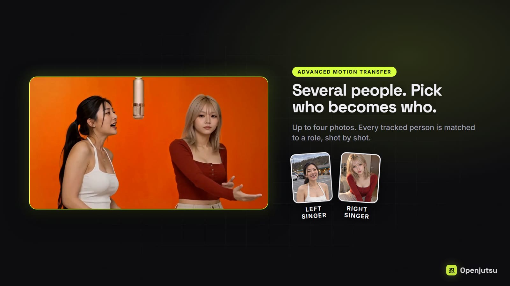
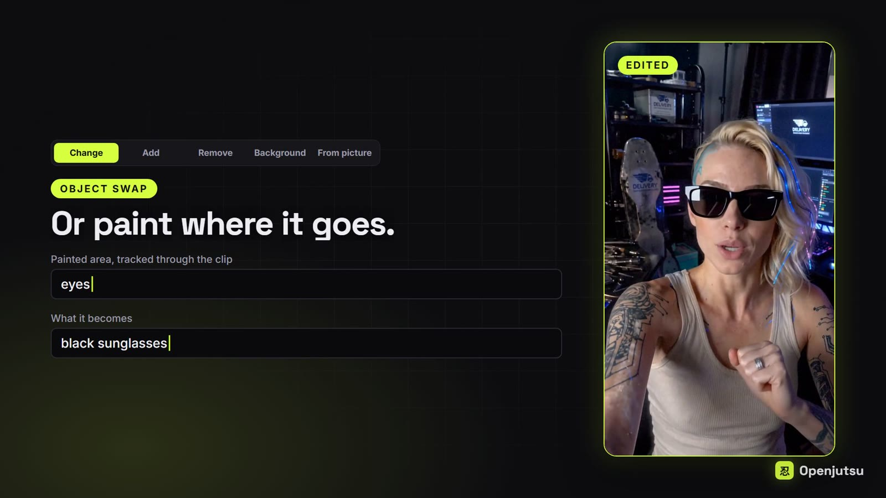
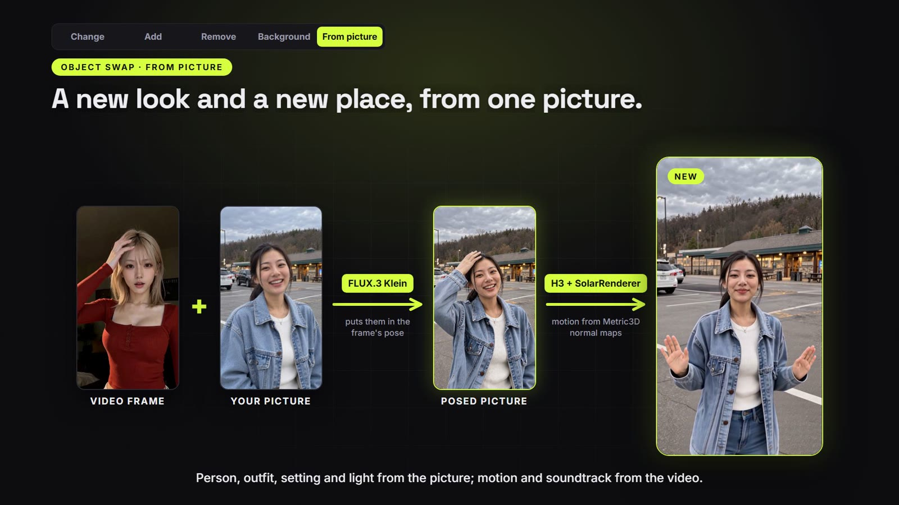
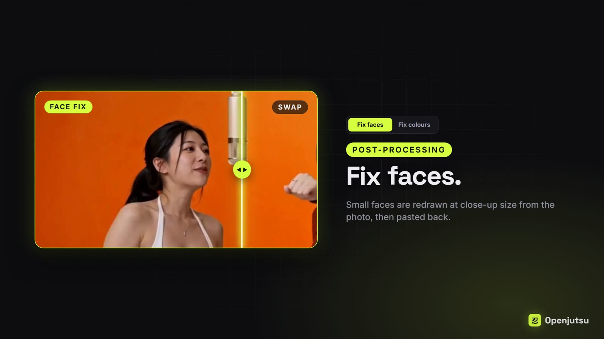

# Openjutsu

An open-source, Genjutsu-style character and object swap for video. Drop a video and a character photo, press **Generate**, and the main person in the video is replaced by your character. Or change their hair or clothes, remove something, or put them somewhere else. The camera, cuts, motion and soundtrack stay. Everything runs on open weights on your own GPU: MiniMax H3 for the video, SAM 3.1 to track people, and Qwen3-VL 8B to describe the pictures and shots.

The app is a small Next.js front end over a ComfyUI workflow. It uses [`@comfyorg/sdk`](https://www.npmjs.com/package/@comfyorg/sdk), following Comfy's [comfy-reshoot](https://github.com/Comfy-Org/comfy-reshoot) reference app.

https://github.com/user-attachments/assets/2d8d763a-1764-49a6-9116-d6d1be661ff6

| Advanced: several people, pick who becomes who | Object swap: paint where it goes |
| --- | --- |
|  |  |
| **From picture: a new look and place from one picture** | **Post-processing: fix faces** |
|  |  |

## First visit: visual describer

The welcome page lets you choose the vision-language model that describes pictures and video frames and writes prompts. Qwen3-VL 8B INT8 remains the default; Qwen3-VL 4B FP8 and Gemma 4 E2B INT8 are smaller alternatives. Install a compatible single-file model including its vision weights in `ComfyUI/models/text_encoders`, then press **Refresh models**. Other installed models can be selected if they support image/video input and text generation through ComfyUI's CLIPLoader and Generate Text nodes. Text-only models and files requiring a different loader are unsuitable.

Choose according to available VRAM and leave room for image/video context and working memory; file size is not a VRAM requirement, and H3 generation has separate memory needs. Your selection is saved in this browser and used for swaps, prompt descriptions and **Find people**. Reopen **Welcome & models** to change it, or use **Visual describer** under Model components. Alternative describers may change prompt quality and person matching. **Set up later** opens the editor; generation still checks the required files. The separate H3 text encoder remains unchanged.

## Modes

- **Simple motion transfer**: available. One character replaces the main person (the one who fills the most of the frame). Runs `workflows/simple.api.json`, exported from `H3 One-Click Single Swap (DMAD 6 step).json`.
- **Advanced motion transfer**: available. 1–4 characters, each with an optional role; every tracked person is matched to a role per shot, and people without a character stay untouched. Runs `workflows/advanced.api.json`, exported from `H3 One-Click Advanced Swap (DMAD 6 step).json`; **One pass per person** (two characters) runs `workflows/advanced_maxq.api.json`.
- **Object swap**: available. **Change** what SAM tracks (hair, a jacket, a car) into what you describe or show in a picture; **Remove** it; or change the **Background** around it (`person` stays). Only that area is regenerated. Runs `workflows/object.api.json`, exported from `H3 One-Click Object Swap (DMAD 6 step).json`.
- **From picture** (under Object swap): FLUX prepares the character in the raw video frame's pose and body cut while keeping the character picture's background. Review or regenerate the image, then choose **Use this image** to set the video length, video and motion-reference resolutions, models, LoRAs, steps and seed. SolarRenderer defaults to four steps with a selectable rank-384 or rank-64 four-step/control pair and supports up to 15 seconds, like the native H3 renderer. SolarRenderer clips longer than six seconds can take considerably longer to render, especially at higher resolutions; see the workflow requirements for the extended-silence node fix. Both LoRA file pickers support `models/loras` and its subfolders. **Render video** reuses the saved preview with normal-map motion guidance and the source soundtrack, in one clip without a context loop. H3 rounds the requested length down to its valid frame grid. See [the workflow requirements](workflows/picture/README.md).
- **Post-processing**: available, for a finished video. **Fix faces**: H3 draws faces poorly when the person is small in the frame, so this redraws the face of the person in a photo at close-up size and pastes it back. Runs `workflows/face.api.json`, written by `workflows/build/openjutsu_face_build.py`. **Fix colours** softens H3's harsh look without an H3 run: Image Detail Contrast takes some fine detail contrast out, then Orion4D's DCTL Tone Mapper grades every frame. Runs `workflows/color.api.json`.

## Requirements

- An NVIDIA GPU. Tested on an RTX 4060 Ti 16 GB with 64 GB of system RAM; the H3 int8 models stream from RAM.
- [ComfyUI](https://github.com/comfyanonymous/ComfyUI) 0.41.2 or newer. Core provides MiniMax H3, SAM 3.1 and TextGenerate.
- Node.js 22.6 or newer, and Python for `comfy-api-proxy`.

### Custom nodes

Install these into `ComfyUI/custom_nodes` (ComfyUI Manager finds the first three by name):

| Pack | Used for |
| --- | --- |
| [SolarRenderer](https://github.com/Enderfga/SolarRenderer/tree/main/comfyui) | From picture: SolarRenderer LoRA loading, conditioning and four-step sampling |
| [ComfyUI-MiniMaxH3-Context-Loop](https://github.com/ethanfel/ComfyUI-MiniMaxH3-Context-Loop) 0.7.3+ | clip loop, checkpoints, final assembly |
| [ComfyUI-Fantastic-MiniMaxH3-PromptBuilder](https://github.com/Adudeguyman/ComfyUI-Fantastic-MiniMaxH3-PromptBuilder) | masked video-edit latent |
| [ComfyUI-KJNodes](https://github.com/kijai/ComfyUI-KJNodes) | Grow Mask With Blur; From picture: VRAM cleanup |
| [comfyui_controlnet_aux](https://github.com/Fannovel16/comfyui_controlnet_aux) | From picture: Metric3D normal maps |
| [ComfyUI-VideoHelperSuite](https://github.com/Kosinkadink/ComfyUI-VideoHelperSuite) | video loading |
| [comfyui-h3-oneclick-swap](https://github.com/D3voz/comfyui-h3-oneclick-swap) | swap and object plans, people and role masks, grey mannequins, track labelling, cut finder, shot list, face-fix chunks |
| [ComfyUI-H3-FaceRefine](https://github.com/Carasibana/ComfyUI-H3-FaceRefine) | Fix faces: face tracking and cropping, SAM face masks, pasting back |
| [ComfyUI-Impact-Pack](https://github.com/ltdrdata/ComfyUI-Impact-Pack) | Fix faces: SAM loader |
| [comfyui-image-detail-contrast](https://github.com/D3voz/comfyui-image-detail-contrast) | Fix colours: Image Detail Contrast |
| [Orion4D_FXMax](https://github.com/orion4d/Orion4D_FXMax) | Fix colours: DCTL Tone Mapper and its presets |
| [comfyui-websocket-reconnect-fix](https://github.com/D3voz/comfyui-websocket-reconnect-fix) | every job: keeps live progress coming after the proxy reconnects to ComfyUI (adds no nodes) |

Restart ComfyUI after installing them.

Before uploading a job, Openjutsu checks the selected workflow against ComfyUI's node and model lists. Missing packs appear with installation links; missing model files appear with their destination folders. Disabled steps are excluded from the check. This checks registered nodes and listed model files, not Python dependencies, model integrity or available VRAM. `COMFYUI_URL` must point at ComfyUI itself (normally `http://127.0.0.1:8188`).

### Models

For **From picture → SolarRenderer**, download [solarrenderer_4step_lora.safetensors](https://huggingface.co/Enderfga/SolarRenderer/blob/main/solarrenderer_4step_lora.safetensors) and [solarrenderer_control_lora.safetensors](https://huggingface.co/Enderfga/SolarRenderer/blob/main/solarrenderer_control_lora.safetensors) from [Enderfga/SolarRenderer](https://huggingface.co/Enderfga/SolarRenderer), or the corresponding rank-64 pair from [mdevoz/SolarRendererRank64](https://huggingface.co/mdevoz/SolarRendererRank64). Put both in `ComfyUI/models/loras` or a subfolder, reload the app and choose their paths in the render settings.

| Folder in `ComfyUI/models` | File |
| --- | --- |
| `diffusion_models` | `minimax_h3_ref2va_pruned_int8_convrot.safetensors` |
| `loras` | `minimax_h3_DMAD_4step_full_lora_avg_rank_39_bf16.safetensors` |
| `text_encoders` | `qwen3vl_32b_minimax_h3_int4_convrot.safetensors` (H3 text encoder) |
| `text_encoders` | `qwen3vl_8b_int8_convrot.safetensors` (describer) |
| `vae` | `minimax_h3_video_vae_int8_convrot.safetensors`, `minimax_h3_audio_vae_fp32.safetensors` |
| `checkpoints` | `sam3.1_multiplex_fp16.safetensors` |
| `ultralytics/bbox`, `ultralytics/segm` | `face_yolov8m.pt`, `person_yolov8m-seg.pt` ([Bingsu/adetailer](https://huggingface.co/Bingsu/adetailer)), for Fix faces |
| `sams` | `sam_vit_b_01ec64.pth`, for Fix faces |
| `insightface/models` | `buffalo_l` (InsightFace downloads it on first use), for Fix faces |

## Run it locally

On Windows, double-click `start_openjutsu.bat` (ComfyUI must be running, or started while it waits). The first run installs `comfy-api-proxy` 0.1.6 into `.venv-proxy` and the node packages, and `patch_proxy.py` fixes the proxy's live progress (node changes and mid-job previews). Each run builds the app, then opens the proxy and the app (`npm start`, the production server) in two windows and the page in your browser. Close those two windows to stop Openjutsu. The manual steps:

1. Start ComfyUI on `127.0.0.1:8188`. On Windows, set `AIOHTTP_NOSENDFILE=1` first (PowerShell: `$env:AIOHTTP_NOSENDFILE = "1"`). Without it, the first partial-file request (the video player sends one when you seek) can stall ComfyUI's `/view`, and every later file download hangs until ComfyUI restarts.
2. Install the proxy, fix its live progress with this repo's `patch_proxy.py` (run it with the same Python), and start it. It serves the Comfy API v2 on `127.0.0.1:8189`. Raise the upload cap for longer videos (the default is 100 MB):

   ```sh
   pip install comfy-api-proxy==0.1.6
   python openjutsu/patch_proxy.py
   comfy-api-proxy run --max-upload-mb 500
   ```

3. Install and start the app:

   ```sh
   git clone <this repo> openjutsu
   cd openjutsu
   cp .env.example .env.local
   npm ci
   npm run build
   npm start
   ```

   While changing the code, `npm run dev` runs the development server instead.

4. Open <http://127.0.0.1:3000>.

`.env.local` sets `COMFY_BASE_URL=http://127.0.0.1:8189`. Leave `COMFY_API_KEY` empty for a local proxy. The base model and LoRA pickers read ComfyUI's model lists from `COMFYUI_URL` (default `http://127.0.0.1:8188`); without it they become text fields.

Uploads are limited to 512 MB total per request, including reference pictures. Uploads are streamed to a temporary folder, and up to three can arrive at once per app process; a fourth is asked to retry shortly. After a job ends, its uploads are removed from comfy-api-proxy, but the files stay in ComfyUI's `input/` folder. Generation continues in ComfyUI independently.

A 6 s clip at 480p takes about 6–13 minutes on a 4060 Ti, most of it in H3 sampling. 736p is the default; 1080p is about 2.5× slower than 736p and needs much more memory. Custom sets an exact width × height from 256 to 2048 px a side (rounded to 32); the video is scaled and centre-cropped to that shape first. It needs the `short_edge` input of the H3 Swap Plan nodes in comfyui-h3-oneclick-swap.

Advanced motion transfer has a **Montage** tab for edited clips where different people take turns within one shot without a hard cut (whip pans, selfie handovers, travel montages). Write roles as "who - looks" ("the dancer - white polo, jeans"): the looks help match the people, and only the part before " - " reaches H3. **Generate** tracks everyone with SAM over the whole video, matches each appearance to the roles with Qwen (a person SAM loses and finds again is matched again, so they keep their photo; Qwen sees each appearance in its frame and close up at three moments, a few appearances at a time, and is asked again about any it skips or matches to one photo twice at the same moment) and makes the video as one chain like Standard, with overlapping clips: each clip has one H3 pass per photo on screen in it (the two with the most screen time) that masks only that photo's appearances, with a prompt about that person only. Appearances on screen for under 12 frames or at under 2% of the frame stay as they are, since H3 draws them as grey figures; the result page lists them. **Find people** (about 3 minutes for 18 s of video) is the optional review: it does the tracking and matching alone, lists the appearances with a photo picker each and saves the tracks, and Generate from that list masks with exactly those tracks. The saved tracks live in ComfyUI's temp folder and are checked against the video, part and size, so after a ComfyUI restart or a change, Find people again. It needs the pack's `H3TrackCrops` and `H3TrackRoles` (which now runs Qwen itself), `H3MontagePeople`, `H3MontageTracks`, `H3MontagePicks`, `H3MontagePlan` and `H3MontagePass` nodes.

## Tips

- **Paint an edit area:** under Object swap -> Change, expand **Paint edit area** and brush extra space around the tracked part. Use the eraser, brush size and keyframe controls to refine it. During generation the painting follows SAM's bounding box in position and scale; it switches off when the track is missing. The edit includes both SAM's mask and the paint, followed by the chosen mask margin. With no paint, Change is unchanged. Update `comfyui-h3-oneclick-swap` and restart ComfyUI for `H3PaintedEditArea`.
- **Add an object:** under Object swap, choose **Add**. Describe the object (for example `a chocolate cake on a plate`) and where it goes (`on the table`). Draw a box covering the whole object and its shadow in the placement editor. An optional reference picture controls its appearance. One box stays fixed on screen; for camera movement, scrub forward and draw more boxes to animate the placement. This uses manual placement keyframes, not SAM tracking. Changing the source video, selected section or resolution clears the boxes. Update `comfyui-h3-oneclick-swap` and restart ComfyUI to load the new `H3ObjectPlacementMask` node.

- Only the main person is regenerated; anyone else in the video stays as they are.
- **Part to use** (under the source video) swaps only part of the video: **Whole**, or a **Length** placed at the **Start**, **Middle** or **End**, fine-tuned with **Starts at**. The sound is cut to the same part, the preview loops it, and Check mask uses it too. A shorter part renders faster (fewer clips).
- **Mirrors and reflections do not work yet**, in either mode. The reflection keeps the original person, and H3 copies their look from it: hair, outfit and build come back on your character. Use videos without a mirror, window or other reflection of the person.
- **Who do they replace?** names the person for the prompt by role (`the singer`), never by clothes: clothing words leak into the result. Leave it blank and the describer names them.
- **What to replace** (Simple mode and Check mask) is the text SAM tracks: `person` by default, an animal such as `cat`, or a short description (`black and white cat`) when the biggest match is the wrong one. The biggest match in the frame is replaced.
- **Hat fix** also masks the hat, so it is replaced too (about 45 s more per clip).
- **No lip-sync** (off by default) is for songs the people in the video do not sing or talk along to. Otherwise H3 makes the new people lip-sync any vocals. It gives H3 silent audio and a prompt saying nobody sings, and shows it the source faces for head turns (about 30 s more per clip); the final video still has the original soundtrack. Mouths can still smile more widely than the source.
- **Check mask** runs only SAM and the mask (about a minute per 3 s of video) and shows a preview you can scrub frame by frame: cyan is the area H3 regenerates, orange the tracked person, and on the right the grey mannequin H3 copies the motion from. Anything outside the cyan area stays as it is. If the character is cut off or too much background changes, set **Mask margin** (Tight, Normal, Loose) and check again; a re-check takes seconds.
- **Motion reference** (under Advanced) is the size of the grey figures H3 copies the motion from: 512 px by default, or 768 or 1376 px. For general, simple videos 512 px is probably enough, but a bigger size does seem to improve quality a bit: H3 follows the source poses and placement more closely. Sampling takes about a third longer at 768 px and about 2.4× as long at 1376 px (H3 uses at most 768×1344 for references). Each size keeps its own saved clips, so switching size renders again instead of resuming.
- **Model components** (under Advanced): choose the H3 Qwen3-VL 32B text encoder quantization and the video and audio VAEs from ComfyUI's installed files. **Use LoRAs** turns all selected LoRAs on or off without removing them. Each LoRA also has its own **Use this LoRA** or **Use speed LoRA** switch; turn off only the speed LoRA to keep style LoRAs and enable Spectrum. **Acceleration → Spectrum** requires [ComfyUI-Spectrum-MiniMax-H3](https://github.com/xmarre/ComfyUI-Spectrum-MiniMax-H3) and is unavailable with an active speed LoRA. DMAD, Turbo, LightX2V and common few-step filenames are recognized; mark renamed speed LoRAs with **Speed LoRA**. Without a speed LoRA, use 20 or more steps. Spectrum is approximate and can change the output.
- Change the **seed** (under Advanced) for a new take. Running the same inputs again resumes from the last finished clip.
- **Steps**, **Base model** and **LoRAs** (under Advanced) default to the H3 pruned INT8 model with the DMAD speed LoRA at 6 steps. LoRAs apply in order; without a speed LoRA, use 20 steps or more. Check mask ignores them.
- **Object swap:** name what SAM tracks in a word or two (`hair`, `jacket`, `poster`), or several separated by commas (`hair, top`) to change them together. Every match changes unless **Only the biggest one** is on (one of each thing). A picture of an outfit, hairstyle, product or place is copied onto it. For **Remove**, say what shows instead only when it is not obvious (`a plain wall`). Mask margin is smaller here (10, 20 or 40 px). Change keeps the outline of what it replaces: a tank top turned into a flannel shirt stays sleeveless.
- **Fix faces:** drop the finished video and the photo the person was made from. **Match the photo** redraws the face from the photo: the closest likeness, but H3 makes up the expressions and mouth movements. **Follow the mouth** keeps the video's expressions and mouth movements, with a little less likeness. Only that person's face changes (matched by face identity); faces taller than a fifth of the frame are left alone, and stretches with only such faces are skipped. A 17 s video at 768p (4 chunks) took about 28 minutes on a 4060 Ti, including model loading. The video is read at 24 fps.
- **Fix colours:** drop the finished video. **Detail contrast** (-0.20 by default) softens crunchy fine detail; above 0 it sharpens instead. The **Tone mapper** starts from the **H3 soft** preset (Reinhard at 20% strength: softer contrast and highlights, blacks and colours kept). It is zuanfilm's H3 preset (also in the list) with less shadow lift and black floor, saturation 1.05 and 20% strength instead of 30%: zuanfilm's version washed out the blacks and dimmed whites by about 12% on H3 videos. The preset list is Orion's saved presets, read from ComfyUI; changing a value under Settings makes it Custom, and the values are sent with the job, so Orion's preset files are not changed. Save `H3 soft.json` in Orion's `presets/color_fx_dctl_tone_mapper` folder to have it in the list; without it the page uses its built-in copy. A 1.75 s 480p clip took 5 s. The video is read at 24 fps.
- **Advanced mode:** give roles as `the drummer`, optionally with how they look after ` - ` (`the drummer - man in a cap`); the look only helps match people and never reaches H3. **One pass per person** gives each of two characters their own H3 pass with only their photo (about twice the time). Check mask is Simple-only for now.

## How it works

Each clip, SAM 3.1 tracks everyone at 1008 px (its own working size), and H3 People Mask keeps the largest person. The edit mask adds 10% headroom above the head, holds each pose for 2 frames and grows by 40 px, so a differently built character has room; it does not affect the motion. The motion reference H3 follows is the source clip with that person turned into a sharp grey mannequin of their exact silhouette, so the pose, arms and fingers stay readable.

`workflows/simple.api.json` is one API export of that workflow with the hat fix and No lip-sync enabled. For each request, `lib/simple.ts`:

- without the hat fix, removes the hat nodes and connects Grow Mask to the People Mask output;
- without No lip-sync, removes the face and mute nodes, so H3 hears the soundtrack and the plan keeps its lip-sync line;
- sets the Swap Plan's resolution, seed, clip length and role.

`lib/model.ts` then sets the Swap Plan's steps and the H3 Diffusion Model file, and replaces the DMAD LoRA node with the chosen LoRAs in a chain (or links the model straight through when there are none). Advanced mode does the same.

`lib/comfy.ts` binds the uploaded video to `VHS_LoadVideo` and the photo to the `LoadImage` node, then submits with the SDK. `/api/jobs/[id]/events` reads the job's raw event stream (the SDK's low-level `getJobEvents`) and forwards it to the page as server-sent events. Node ids are turned into node titles and clip numbers there: each clip after the first is a graph expansion of the loop, whose node ids carry a prefix per clip (`64`, `66.0.0.64`, `66.0.0.Recurse.0.0.64` for Save Clip in clips 1–3). The final MP4 is the output of the Final Video node (`MiniMaxH3ChainAssemble`, node `67`).

`workflows/mask.api.json` is the mask check: the same SAM, People Mask and grow settings over the whole video, with the mask tinted over the frames next to the mannequin, saved as an MP4.

Advanced mode labels the people before it masks them. Per clip, H3 Track Crops shows each SAM track once per shot (the person alone, and the frame with them boxed) to Qwen3-VL 8B, which names the subject or "other"; H3 Track Roles reads that answer and settles a subject named twice in one shot by colour. H3 Role Mask builds the edit mask from the labelled tracks only, and the shot-list describer sees each labelled person outlined in their subject's colour, so the prompt names the same people the masks do. `lib/advanced.ts` finds nodes by title, drops unused picture branches and, without the hat fix or No lip-sync, their nodes; the exports are made from `workflows/build/oneclick_advanced_build.js` with every optional group on.

Object swap uses the same masked edit for the tracked things; SAM 3 tracks each comma-separated thing as its own prompt. The H3 Object Swap Plan writes a MiniMax video-editing prompt (`[video editing + reference generation + audio reuse]`), and the shot-list describer is told not to mention the thing being changed. **Change**: the tracked area is regenerated, and the motion reference shows it as a grey shape that keeps its shape and movement but not its colours. **Background**: the grown person mask is inverted (`flip_input`), so the edit reaches a little into the person's edge, and the whole background turns into a grey blur that keeps the camera movement. **Remove**: there is no motion reference (a grey shape would come back as a grey object), and the prompt describes what fills the area without naming what was there. `lib/object.ts` makes these changes by node title.

Fix faces works on the face, not the frame. H3 Face Track + Crop follows the face of the person in the photo over the whole video (InsightFace picks them out when there are several) and crops it to 512×512, so a face a few dozen pixels tall fills the canvas. H3 Face Fix Chunks splits the crops into independent chunks (6.5 s by default, overlapping by at least 1 s) and outputs them as lists, so ComfyUI runs the H3 nodes once per chunk. Each chunk is a masked edit: only the SAM face mask is regenerated with the photo as reference, while the hair, ears, collar and background around it stay, which keeps the new face from sliding against the head. For Follow the mouth, a blurred copy of the crop is the motion reference. H3 Face Fix Join crossfades the chunk overlaps and lowers the per-frame paste weight where the face is large, and H3 Face Stitch pastes the face back through a slightly smaller mask with the original soundtrack. The chunks are not chained through the context loop: each one starts from the swap's own frames, so colours do not drift. `lib/face.ts` removes the blurred face for Match the photo and sets the seed and chunk length.

The swap workflows are built by the scripts in `workflows/build/`: `oneclick_single_build.js` (Simple), `oneclick_advanced_build.js` (Advanced; set `globalThis.H3_MAX_QUALITY = true` first for One pass per person), and `oneclick_object_build.js`. To rebuild one, open ComfyUI in the browser with an empty workflow tab (each script clears the active tab), run `const app = window.comfyAPI.app.app;` in the developer console, paste the script, enable its optional groups (hat fix, No lip-sync) where the export needs them, export **Workflow (API)** and replace the matching `workflows/*.api.json`. Fix faces is written by `python workflows/build/openjutsu_face_build.py`. If node ids change, update `NODES` in `lib/simple.ts`. `npm test` checks the pruning against the exports.

## Deploy on the Comfy Developer Platform

Not tested yet. The app code does not change, only `.env.local`:

1. Package the prepared ComfyUI install (with the custom nodes and models above) as a Build, and deploy it:

   ```sh
   pip install comfy-cli
   comfy setup --where cloud
   cd /path/to/ComfyUI
   comfy build init --name openjutsu --models-dir ./models --custom-nodes-dir ./custom_nodes
   comfy build status
   comfy build push --release --target linux/nvidia
   comfy deploy refs compute
   ```

2. Create a deployment from the released Build on the Developer Platform. The workflow has only been run on a 16 GB card with 64 GB of system RAM, so choose at least that.
3. Set `COMFY_BASE_URL` to the deployment URL and `COMFY_API_KEY` to a key from the workspace that owns it. The key stays on the server; never put it in a `NEXT_PUBLIC_` variable.
4. Before hosting or tunneling the app, set a strong `OPENJUTSU_PASSWORD` and use HTTPS. Without a password, Openjutsu refuses to start on any address but loopback. It also refuses a password shorter than 12 characters. After 5 wrong passwords a client must wait before each try, from 1 second doubling to 5 minutes; clients are told apart by their `X-Forwarded-For` address, which only a proxy or tunnel that sets it makes reliable, so 20 failures spread across clients make everyone wait too. Open the page and sign in as `openjutsu` with that password; the same browser login protects uploads, job controls, progress and downloads. This is a single-owner app: everyone given the password shares access to its jobs. The start-up check cannot see a tunnel or reverse proxy on the same machine, so never point one at a password-free server.
5. Host the Next.js app anywhere that runs Node. `npm start` listens on `127.0.0.1` only; to serve on a network address, build and start Next with the password set (Next uses `PORT` if the host sets it, otherwise 3000):

   ```sh
   npm run build
   OPENJUTSU_PASSWORD='<strong password>' npx next start --hostname 0.0.0.0
   ```

   Streaming progress needs a host that keeps long responses open. Preserve the public Host and scheme when reverse proxying so same-origin API checks work.

Notes:

- Resuming relies on clip checkpoints in ComfyUI's `output/` folder, which a fresh serverless worker does not have.
- A job runs for many minutes; check the deployment's request time limit.
- Stop or delete the deployment when you finish, to end GPU charges.

## License

MIT, see [`LICENSE`](LICENSE). Model licences are separate. Fix faces depends on InsightFace `buffalo_l`, which is licensed for non-commercial research only, and on the Ultralytics YOLO weights from Bingsu/adetailer, which are AGPL-3.0.
